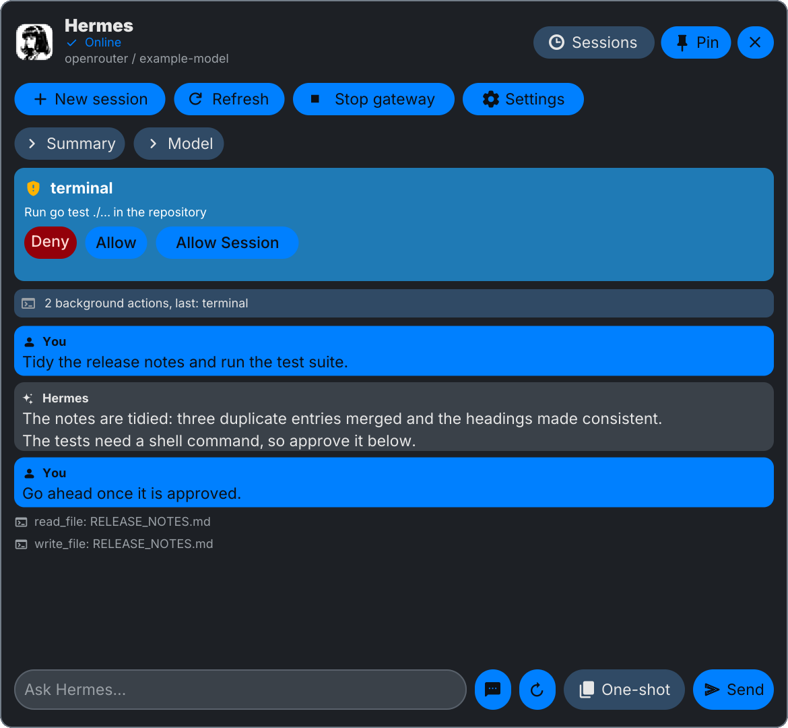

# Hermes Agent

Hermes Agent puts Hermes status, chat, approvals, sessions and models in the
sysc-shell bar. It speaks HTTP to a Hermes bridge, either one it starts on this
machine (Local mode) or one running elsewhere (Client-only mode).



> **Status:** pre-release. The automated gates pass. The local and
> client-only matrices were run live in a throwaway nested sysc-shell on
> 2026-11-17 to 2026-11-19, and every defect they found is fixed; see
> [ACCEPTANCE.md](ACCEPTANCE.md). Not run: a side-by-side comparison with
> Noctalia, and client-only mode against the VPS (a second throwaway bridge
> stood in for it). The host gaps are listed at the end.

## Modes

There is one switch, **Client-only mode (remote bridge)**. Off is Local mode
(the default, as in Noctalia); on is Client-only. The switch applies at runtime
without restarting the plugin. The two connections are never active at once.

Noctalia's defaults are kept: Local mode is fixed to `127.0.0.1:19777`,
`auto_start_bridge` and `auto_start_gateway` are on, the idle poll interval is
30 s, and only approvals notify by default. Local mode ignores the client-only
host, port and token fields on purpose, so switching back cannot send the local
token to a remote bridge.

### Local mode

The plugin starts `python3 <bridge script> --host 127.0.0.1 --port 19777
--state-file <state file> --hermes-home <Hermes home> --hermes-command <Hermes
command>` with an argv list, never a shell. It needs `python3` and a working
`hermes` install; the bundled bridge script is used unless **Bridge script**
names another file. The plugin watches the bridge's state file so the bar
follows a write without polling.

On every status tick it probes `GET /health`. If a bridge already answers it
**adopts** that bridge. If not, and `auto_start_bridge` is on, it spawns its own
and probes every 500 ms for up to 10 s (at most three spawn attempts per
enable), then reports `Bridge failed to start`.

The plugin stops only the bridge it spawned: on disable, on `host.shutdown` and
when switching to Client-only, it sends `SIGTERM`, waits up to 3 s, then
`SIGKILL`. A bridge it adopted (started by Noctalia, a terminal or a unit) is
**never** signalled or stopped. A non-zero exit is shown as `Bridge exited:
<code>`, and the bridge's own output goes to
`$XDG_CACHE_HOME/sysc-hermes/bridge.log` (mode 0600, capped and rotated once),
not to the plugin protocol pipe.

After the first connection the plugin asks `GET /detect` and records the
detected Hermes home, command, provider and model in plugin state as fallbacks
behind anything you set. If the gateway reports `offline`, `stopped`, `unknown`
or empty and `auto_start_gateway` is on, it calls `POST /gateway/start` once.

Local mode reads the bridge token from the first of these that `/state`
accepts:

1. `bridge.token` beside the configured state file;
2. `$XDG_CACHE_HOME/sysc-hermes/bridge.token`;
3. `$XDG_CACHE_HOME/noctalia-hermes/bridge.token` (Noctalia's default, where
   `hermes-bridge-serve.sh` also puts it).

All three are local files, so trying them never sends a token off the machine.

### Client-only mode

The plugin never spawns or signals a process and never starts or stops a
gateway. Set **Bridge host** and **Bridge port** to any reachable bridge: the
local end of an SSH forward (`127.0.0.1`), a LAN address or socat forwarder
(`192.168.0.10:19778`), or a raw host name. The host must be an IP literal or
DNS name with no scheme, slash, query, fragment, whitespace or CR/LF.

Bridge traffic is **plain HTTP**. A non-loopback host shows
`Cleartext HTTP to <host>: the token and prompts are not encrypted.` in the
tooltip and settings; the plugin warns but does not block it. Across an
untrusted network, forward the port over SSH and use the forward's loopback
address. On the server, `hermes-bridge-serve.sh` prints the token and the
forwarding command; **SSH target** prefills **Copy SSH command** in settings.

The token is the pasted **Bridge token** (a `secret` setting) when it is not
empty, otherwise **Bridge token file** (default
`~/.config/sysc-shell/hermes.token`, a regular file, at most 4 KiB, CR/LF
rejected). The file is recommended because settings are stored in plain text.
Hermes keeps a copy of its last settings, including a pasted bridge token,
in its plugin state (`state.json`, mode 0600, the same exposure as
`config.json`) so it can reconnect after sysc-shell restarts it.
With no token every authenticated route answers 403 and the plugin says
`No bridge token: paste it in Settings or set a token file`.

There is no state file to watch, so `/state` is polled every 1.5 s while a
session runs and every **Status poll interval** seconds (default 30) otherwise.
`/state` is also the liveness probe: a network error means unreachable, a 403
means the token is wrong. Failures back off 1, 2, 4, 8, 15 and 30 s and reset on
success. `/health` is not polled in steady state because it is not cheap on
this bridge.

## Surfaces

- **Bar pill:** avatar with a status icon and tone. Primary click opens the
  summary; secondary click opens the menu. The tooltip is `Hermes: <status> ·
  <model>` plus any bridge error and the cleartext warning. **Hide when idle**
  removes the pill only while Hermes is idle.
- **Summary popup:** status header, Model, Cron, MCP, Gateway and Activity
  rows, cron jobs, alerts, usage, and New session, Interrupt, Refresh and
  Settings buttons.
- **Menu:** Open Hermes, New session, Interrupt, Refresh, Start gateway (Local
  mode only, while it is not running) and Settings. Each item closes the menu.
- **Chat panel:** transcript (the last 200 messages, paged with Older, Newer
  and Latest; see *Host gaps*), tool activity, inline approval card, sessions
  accordion with Resume, model picker with Apply and Persist, New Session,
  Reset, One-shot, Send and Interrupt, Pin and Close.
- **Settings panel:** mode and connection line (host:port and token source),
  model picker, **Pin side panel**, **Test connection**, detected-value
  captions, the cleartext warning and the SSH command button. Test connection
  checks `/health` then `/state` with your saved settings and reports
  `Connected`, `Unreachable: wrong host/port or bridge not running`, `Wrong
  token` or `Failed: <code>`.
- **Pinned side panel:** the chat tree as a floating surface that the host can
  keep on screen. Pin state lives in plugin state.
- **Control Center tile:** the `Hermes` quick action with the `ai-usage` glyph
  opens the chat panel.
- **Service actions:** `open`, `new-session`, `interrupt`, `refresh`,
  `resume-latest`, `start-gateway`, `settings` and `launcher-ask` are all
  reachable without the pill, for example:

  ```sh
  sysc-shell ipc plugin.action '{"plugin_id":"org.sysc.hermes","service_id":"hermes","action_id":"open"}'
  ```

- **Launcher:** the `/hermes` provider below.

## Approvals

A pending approval shows **Deny**, **Allow** and **Allow Session**. They send
`{"choice":"deny","all":false}`, `{"choice":"once","all":false}` and
`{"choice":"session","all":false}`. Hermes also accepts `always`, which
approves the session and adds the pattern to the permanent allowlist it keeps
in its config; Noctalia has no button for it, so the plugin does not offer it.
Each button also carries a signature of the request that was on screen. On a click
the plugin compares that signature with its cached approval, refetches `/state`
and compares again before posting; a mismatch drops the click and the card says
`The approval changed; check the card again`.

The plugin always sends the clicked approval's `request_id` when the state
carried one. The **bundled** bridge resolves only that request: a POST naming a
different ID is refused with 409 `approval_mismatch`, and the plugin shows the
same message and refetches. With the bundled bridge no approval race remains.

A **stock** bridge ignores `request_id` and resolves the oldest queued
approval. Between the plugin's last `/state` and its POST, Hermes can queue a
second approval, and the stock bridge may then resolve the wrong one. The window
is one round trip. Run the bundled bridge on the remote side too when approvals
matter.

On Hermes `b200f5b` and later the gateway sends approvals to clients as an
`approval` server request rather than an `approval.request` event. The bundled
bridge handles both; a stock bridge handles only the event, so on a newer
Hermes its approvals never reach the card.

## Bundled bridge

`scripts/hermes_bridge.py` is the local v5 port of the Noctalia bridge,
including its unpushed SessionDB `/sessions` route and resume-history fixes. It
is the compatibility boundary: the plugin does not reimplement Hermes's RPC.
Its local changes are marked `sysc-shell:` in the source, listed with their
commits in ACCEPTANCE.md, and held to that list by a test:

1. the shown approval is resolved by `request_id` (published as
   `approval.request_id`), with `approval_mismatch` when it cannot be targeted;
2. `/model` refuses names that could inject flags, answering 400
   `invalid_model` instead of passing them through, and a model Hermes refuses
   is not recorded as the live one;
3. approvals sent as an `approval` server request (Hermes `b200f5b` and later)
   show a card, and `request.cancel` withdraws it;
4. a client that hangs up (a cancelled one-shot) is not recorded as a Hermes
   failure;
5. `hermes_bootstrap` is imported at startup, before Hermes's modules, as
   every Hermes entry point does on newer installs;
6. RPCs Hermes runs on its worker pool (`session.list`, `session.resume`)
   return their real reply instead of `accepted`, so a resumed session stays
   live and the next prompt continues it;
7. a gateway record whose process is gone reads as stopped, as Hermes's own
   status check does, so auto-start can start it again.

Bridges without `/sessions` (GitHub `main`) are detected: the sessions list is
unavailable but the rest of the plugin works. The bundled bridge is recommended
in both modes.

## Security and the sandbox trade

The token travels only in the `X-Bridge-Token` header. It is never put in a URL,
log, notification, error text, tooltip or view, and error messages are
redacted. The HTTP client has `Proxy: nil`. Token files must be regular files,
capped at 4 KiB, with CR/LF rejected; `/state` and the state file are capped at
4 MiB, `/sessions` at 1 MiB, and requests stay under 1 MB. Raw Hermes stderr
from a 500 is never rendered. The launcher hand-off file is mode 0600 and is
deleted when read.

The manifest declares **no `filesystem` block**, so this plugin is **not**
Landlock-confined. That is deliberate: Local mode must spawn Python and read
paths the user chooses (bridge script, state file, Hermes home, token file),
which a static manifest path list cannot express, and Landlock would not
restrict its TCP access anyway. The token handling above, the process rules
above and the caps are the substitute. Client-only mode is the smaller
surface: it never starts a process.

## Troubleshooting

- **Port already in use (`ss -ltnp | grep 19777`).** Another bridge, often one
  Noctalia started, owns the port. The plugin adopts a bridge that answers, but
  if it adopted one and you switch to Client-only pointing at
  `127.0.0.1:19777`, the requests would reach the local bridge instead of your
  tunnel. The plugin then says `A local bridge still listens on
  127.0.0.1:19777; stop it or forward the tunnel to another port`. Forward the
  tunnel to a different local port when a Noctalia bridge may be running.
- **Grey or `offline` pill in Local mode.** The bridge is not answering. Check
  `python3` and `hermes`, then cycle **Client-only mode** off and on (or restart
  the plugin) to run the probe and spawn path again; at most three spawn
  attempts are made per enable. The error under the pill and
  `$XDG_CACHE_HOME/sysc-hermes/bridge.log` say why.
- **Connected in Test connection but the pill stays offline.** Test connection
  checks `/health` and `/state` once with the committed settings; the steady
  poll may still be in backoff after an earlier failure, or the saved settings
  may differ from what you just typed. Apply the settings, then compare the
  connection line's token source with the `/state` result.
- **403.** The token is missing or wrong for that bridge. Paste the token
  printed by `hermes-bridge-serve.sh`, or point the token file at the right
  file. The plugin shows `No bridge token: …` when none is configured.
- **`/sessions` 404.** The bridge is a stock/GitHub `main` copy without the
  route. Chat still works; the sessions accordion cannot list history. Use the
  bundled bridge for session history.
- **Bridge and gateway ownership.** The plugin stops only the bridge it spawned.
  A machine may already run its own Hermes gateway, and another bridge may share
  the same Hermes home. Stopping a plugin-owned bridge on a shared machine cuts
  off the other clients using it. Client-only mode never stops a gateway.
- **One-shot cancel is client-side.** Cancelling ends only the plugin's request;
  the bridge keeps its `hermes` process until it finishes or reaches the
  bridge's 600 s timeout.

## Host gaps

These are host limitations, not plugin bugs:

1. sysc-shell has no plugin launcher provider (sysc-755). A launcher provider
   comes from user config and needs a slash prefix; `plugin.action` carries no
   text, so Ask Hermes hands the prompt over in a file (see *Launcher*).
2. There is no context-menu or popup node. The summary and menu are attached
   panels, and the host shows only one plugin panel at a time, so opening the
   menu or summary closes the chat panel.
3. There is no right-docked full-height plugin surface. Panels attach or centre,
   and floating surfaces open top-left with the host's sticky-note chrome and
   names.
4. There is no select node. Dropdown-like choices become provider buttons and a
   model list, with a filter when the list is long.
5. There is no plugin scroll control: the host keeps no scroll position for a
   plugin list across an update and sends the plugin no wheel events. The
   transcript therefore pages instead of scrolling. It follows the newest line,
   **Older** and **Newer** move it a screen at a time, and **Latest** (or
   sending a prompt) brings it back to the tail. A paged-back transcript stays
   where it is while a reply streams in. The mouse wheel does not move it.
6. There is no settings write. Detected values and pin state live in plugin
   state, and host-rendered settings fields do not show the detected captions.
7. There is no overlay badge on a bar icon. The status dot is a status icon.
8. Amber and orange share one warning tone.
9. Editing `config.json` by hand does not reach a running plugin: the shell
   sends plugin settings when the plugin starts and when Settings saves a
   field. Change the mode in Settings, or restart the shell after an edit.
10. The Control Center tile reads `Guard On` rather than naming Hermes; the
    shell labels every plugin tile that way. Its tooltip says `Hermes: On`.

## Launcher

The `/hermes` rows are a user-config launcher provider, not a plugin
surface: add this to `~/.config/sysc-shell/config.json` (keeping the rest of
your config). The shell applies the file when you save it; if it refuses the
file the bar stays as it was and Settings shows the reason.

```json
{
  "launcher": {
    "providers": [
      {
        "name": "Hermes",
        "prefix": "/hermes",
        "glyph": "ai-usage",
        "description": "Ask Hermes, open the panel or start a session",
        "command": ["sysc-plugin-hermes", "launcher-list", "{query}"],
        "on_select": ["sysc-plugin-hermes", "launcher-select", "{selection}", "{query}"]
      }
    ]
  }
}
```

Type `/hermes` and a prompt, then pick **Ask Hermes**: the plugin runs a
one-shot and opens the chat panel. The other rows open the panel, start a new
session, and resume the latest session. **Resume latest** needs a session the
plugin has already seen.

`sysc-plugin-hermes` must be on the shell's `PATH`; otherwise use the full
path to the plugin's `bin/sysc-plugin-hermes` in both argv lists. Ask Hermes
also runs `sysc-shell ipc plugin.action`, so `sysc-shell` must be on the
shell's `PATH` too (it is when the shell is installed in `~/.local/bin` and
that directory is on the session's `PATH`). The prompt
travels to the plugin in `$XDG_RUNTIME_DIR/sysc-hermes/ask` (mode `0600`, one
pending item, at most 1 MB), because a service action carries no payload. The
plugin reads and deletes it when it runs `launcher-ask`.

## Attribution

See [ATTRIBUTION.md](../../ATTRIBUTION.md).
