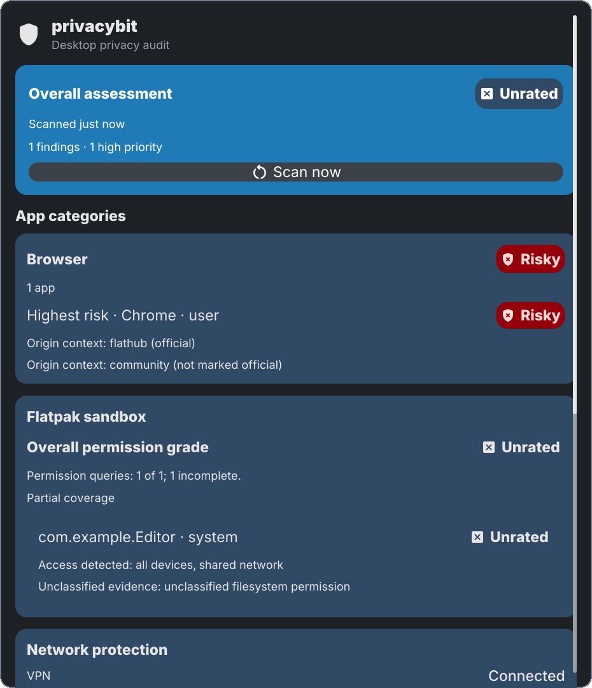

# Privacybit

Privacybit adds a user-placeable bar item and a read-only desktop privacy audit
panel to sysc-shell.

## Open the panel

In **Settings → Bar**, add **Privacybit** from the plugin widgets. Click its
shield and grade label in the bar to open the panel. The Control Centre's
**Privacy** page also has an **Open full audit** button.

The panel shows the overall grade, app categories, origin context, a separate
Flatpak sandbox grade with bounded per-installation evidence, VPN observations,
findings, and coverage limits. Origin names include whether each source is
marked official; they do not change grades. When the app list is capped,
highest-risk copies appear first. Use **Scan now** to refresh the audit. The bar
and Control Centre read the same published result. Older or unavailable results
appear as **Unrated**, and capped lists say how many entries are hidden.

Install `privacybit` separately. The plugin checks `PATH`, then
`~/.local/bin/privacybit`; if neither is executable, it shows an explicit
unavailable state. Scans run as the current user and do not use root.

This plugin is licensed under GPL-3.0-or-later. The repository's existing
license remains in effect for its other plugins.
