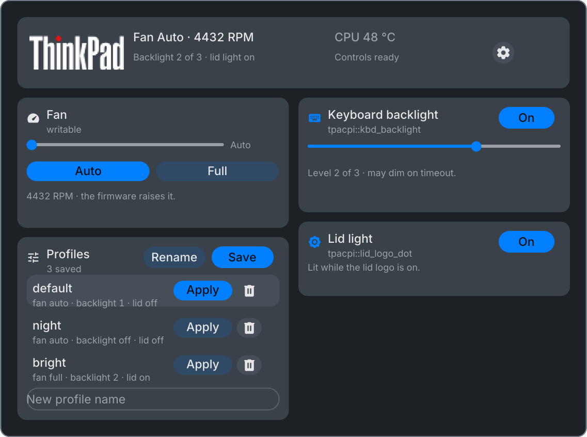

# ThinkPad controls

ThinkPad adds a small Lenovo wordmark to the bar. Click it with either mouse button to open a panel for the fan, keyboard backlight, lid logo light, CPU temperature, and saved profiles.




The controls follow the hardware each model exposes. The fan uses the levels reported by `thinkpad_acpi`; a numbered level does not map to the same RPM or noise on every model. The keyboard slider follows that LED's `max_brightness` value.

## Install from source

ThinkPad is source-only until its catalog release. From the repository root, run:

```sh
make install
```

This builds and links the plugins in the checkout. Keep the checkout in place, then enable ThinkPad in the sysc-shell plugin manager. Use a sysc-shell build that supports plugin protocol 1.17, sliders, and bar images.

## Grant hardware access

The panel shows **Copy fix** when the current user cannot write to the controls. Copy the script, review it, and run it in a terminal. It creates the `sysc-thinkpad` group, grants the group access to the fan and ThinkPad LEDs, and installs udev rules to restore those permissions after boot.

The script also enables `thinkpad_acpi` fan control. For a loadable module, it writes the modprobe option and reloads the module. A built-in driver ignores `/etc/modprobe.d`; add `thinkpad_acpi.fan_control=1` to the bootloader's kernel command line, regenerate entries if needed, and reboot. The script prints that instruction because bootloader configuration varies.

Log out and back in so sysc-shell receives the new group, then press **Re-check** in the panel. `newgrp sysc-thinkpad` updates only programs launched from that terminal. If your account has a lingering systemd user manager and the panel still reports read-only, save your work, run `systemctl --user exit`, then sign in again. This stops the services managed by your account.

## Controls and profiles

- The fan slider selects numbered levels 0 to 7. **Auto** returns control to the firmware; **Full** pins the fan at full speed.
- The keyboard slider uses the range advertised by the backlight. Its toggle turns the light off without forgetting the selected level.
- The lid toggle controls the logo light.
- The panel displays CPU package temperature and fan RPM. The thermal warning defaults to 85 °C; it warns about heat but does not override a pinned fan level.
- Profiles save the fan and light settings together. Direct control changes update the active profile.

The plugin stores profiles at `$XDG_STATE_HOME/sysc-plugins/thinkpad.json`, or at `~/.local/state/sysc-plugins/thinkpad.json` when `XDG_STATE_HOME` is unset. On first run it creates `default`, `night`, and `bright` profiles. The **Profile applied on start** setting pins a profile by name. Leave it blank to restore the last profile applied in the panel.

## Troubleshooting

- Some models do not expose `tpacpi::thinklight` or a lid logo LED. The plugin hides the missing control and keeps the others available.
- A read error for `brightness_hw_changed` does not affect backlight control. Some kernels return `EIO` for that optional attribute.
- If a control stays read-only, check the `sysc-thinkpad` group and refresh the user manager. The panel's **Re-check** button probes the permissions again.

## Measure a fan curve

The probe is read-only by default. From the repository root, run `go run ./cmd/sysc-thinkpad-probe -fan-ladder` to measure each numeric level advertised by the kernel. It holds each level for two seconds, prints the RPM, and restores the level it found at startup. Ctrl-C or SIGTERM stops the scan and restores that starting level. Fan response varies by model, so the scan does not recommend a level for you.
